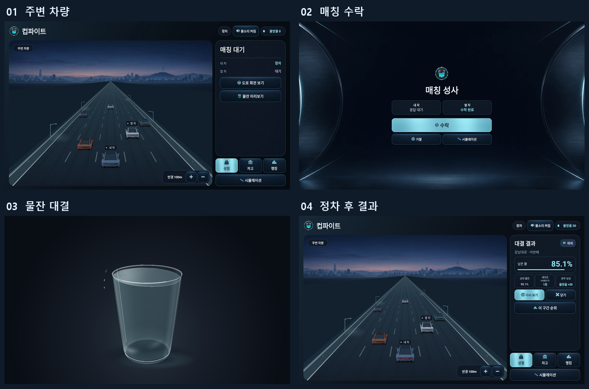

# 컵파이트 0.9.4 시연 자료

| 파일 | 형식 |
| --- | --- |
| [유튜브 일반 시연 영상](cupfight-youtube-demo-0.9.4.mp4) | 1920×1080, 41.5초, 자막·편집 배경음 |
| [유튜브 Shorts 영상](cupfight-shorts-0.9.4.mp4) | 1080×1920, 41.5초, 장면별 확대·자막·편집 배경음 |
| [원본 자막 시연 영상](cupfight-demo-0.9.4.mp4) | 1280×900, 41.5초, 무음 |

[유튜브 업로드용 제목·설명](youtube-upload-texts.json)

현재 공개된 0.9.4 debug APK를 일반 Android API 34 에뮬레이터(1280×800, density 160)에서 직접 조작해 녹화했습니다. 차량이 달리다 정차하고, 전체 화면 매칭에서 상대 수락을 확인한 뒤 수락하면 내 물잔 하나로 경기가 진행됩니다. 경기 종료 후 정차 상태에서 결과와 완주 보상을 확인하고 상점의 움직이는 날개를 미리 봅니다.

상대 차량과 주행 데이터는 한 기기의 모의 입력입니다. 실제 이용자 간 네트워크 매칭, 실차 주행 또는 공식 Pleos Connect 에뮬레이터에서의 검증 영상이 아닙니다. 영상 속 물잔 전체 화면은 일반 Android debug 시연 화면이며 차량의 주행 화면 허용을 보장하지 않습니다. 차량 환경에서는 플랫폼의 화면 사용 제한을 따릅니다.

영상은 앱 코드와 APK를 변경하지 않은 상태에서 촬영했습니다. 시작 화면과 시뮬레이션 메뉴 전환을 덜어내고 두 녹화 구간을 연결했으며, 빈 OS 여백을 자르고 설명 자막을 추가했습니다. 재생 속도는 변경하지 않았습니다. 원본 자막 시연 영상은 무음이며, 유튜브용 두 편에는 이 편집을 위해 합성한 배경음을 추가했습니다. 배경음은 실제 앱 오디오 녹음이 아닙니다. 30fps 인코딩은 앱의 실시간 성능 측정값이 아닙니다.

Shorts의 앱 화면은 같은 원본 녹화를 장면별로 잘라 확대했습니다. 앱 화면이나 경기 결과를 새로 그리지 않았습니다. [편집 스크립트](../../tools/build_submission_videos.py)와 [영상 정보](submission-video-info.json)를 제공합니다.

결과 화면은 내 물 85.1%, 상대 물 95.1%, 세이프 브레이크 1회, 완주 보상 물방울 30개입니다. 마지막 장식은 구매·장착이 아닌 상점 미리보기입니다.

- [실행 절차와 APK](../../README.md)
- [촬영 및 편집 정보](capture-info.json)
- 촬영한 앱 코드 기준: `dd965d814e098c7d68a814bc5b323ff40a7b04fe`
